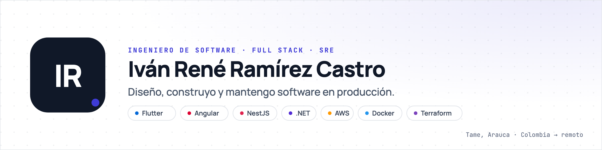

<picture>
  <source media="(prefers-color-scheme: dark)" srcset=".github/assets/banner-oscuro.png">
  <source media="(prefers-color-scheme: light)" srcset=".github/assets/banner-claro.png">
  
</picture>

<p>
  <a href="https://www.linkedin.com/in/ivanramirez-in"></a>
  <a href="mailto:ivanrene10@gmail.com"></a>
  <a href="https://wa.me/573122760392"></a>
  <a href="https://ivanrene.com"></a>
</p>

Soy **Ingeniero de Sistemas** de la Pontificia Universidad Javeriana, con matrícula profesional COPNIA vigente, y llevo más de cinco años construyendo software de punta a punta: web, móvil, backend e infraestructura. Trabajo en remoto desde Tame, Arauca.

*Software engineer (Full Stack · SRE) based in Colombia, working remotely with teams in the US and Latin America.*

### Ahora

- **Full Stack y SRE** en la plataforma de un hotel inteligente que opera 24/7: monitoreo, atención de incidentes y pipelines de CI/CD.
- **Socio en [Freeloz](https://github.com/freeloz)**, donde construyo productos a medida.

### Con qué trabajo

| Área | Herramientas |
| --- | --- |
| Web | Angular · Vue · Next.js · Astro |
| Móvil | Flutter (Bloc, GetX, Provider) |
| Backend | NestJS · .NET · LoopBack 4 · Hasura · REST y GraphQL |
| Datos | PostgreSQL · MySQL · SQL Server · MongoDB · SQLite · Elasticsearch |
| Nube y operación | AWS · Azure · Cloudflare · Docker · Terraform · CapRover · GitLab CI/CD · Linux |
| IA | OpenAI · Anthropic · Amazon Bedrock |

### Proyectos

| Proyecto | Qué es | Stack |
| --- | --- | --- |
| **Micro · Campeonato Regional**<br>[demo](https://micro.freeloz.com) · [API](https://api-micro.freeloz.com) · [web](https://github.com/ivanramirez-git/torneo-de-micro-web) · [api](https://github.com/ivanramirez-git/torneo-de-micro-api) | Landing y panel para gestionar torneos, equipos, fases y partidos, con goles, tarjetas y faltas. API documentada con Swagger y analíticas con Ackee. | Vue 3 · LoopBack 4 · MongoDB · MinIO · Terraform · AWS EC2 · CapRover |
| [**mongodb-backup-s3**](https://github.com/ivanramirez-git/mongodb-backup-s3) | Copias automáticas de MongoDB a almacenamiento compatible con S3, con interfaz web para gestionarlas. | Node.js · MongoDB · MinIO / S3 |
| [**flutter_base**](https://github.com/ivanramirez-git/flutter_base) | Base para proyectos Flutter con arquitectura limpia y escalable. | Flutter · Dart |
| [**template-dot-net-sql-angular**](https://github.com/ivanramirez-git/template-dot-net-sql-angular) | Plantilla de proyecto con backend .NET, SQL Server y frontend Angular. | .NET · SQL Server · Angular |

Antes: AucolApp (alojamiento estudiantil, Flutter + Angular + MongoDB), La Villa Agropecuaria (app de clientes en Flutter sobre AWS) y ProfesCheck (Firebase).

### Contacto

Si tienes un proyecto o una vacante, escríbeme a [ivanrene10@gmail.com](mailto:ivanrene10@gmail.com) o por [WhatsApp](https://wa.me/573122760392?text=Hola%20Iv%C3%A1n%2C%20vi%20tu%20perfil%20de%20GitHub).

```
$ status --ivan
● todos los sistemas operativos
```
